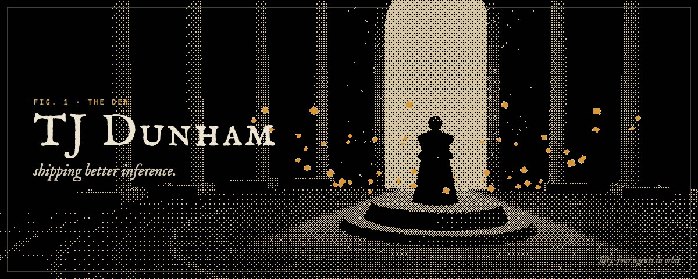

  

  <a href="https://ferrumvir.github.io/FerrumVir/"><b>enter the den</b></a> &nbsp;·&nbsp; <a href="https://x.com/realtjdunham">x</a> &nbsp;·&nbsp; <a href="https://github.com/FerrumVir/arc-chain">arc-chain</a>

