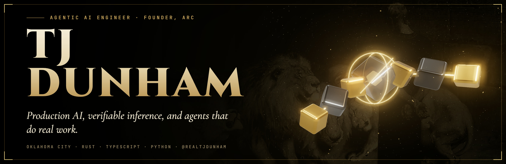
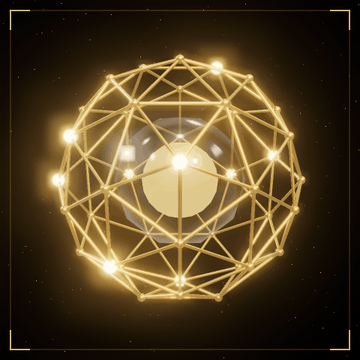
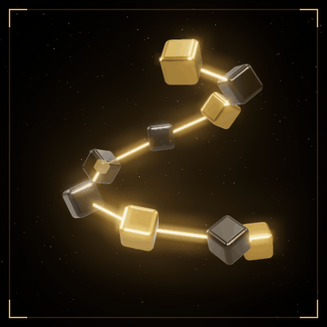
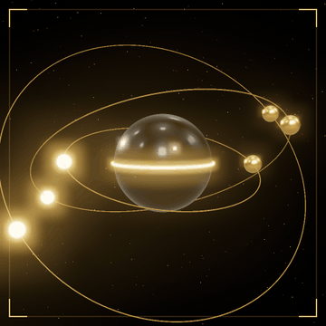

  

  
  
  

<i>Agentic AI engineer and two-time founder. I build production AI systems and keep them running.</i>

<table align="center">
  <tr>
    <td align="center" width="33%"> <b>Enterprise AI platform</b> Live in production in two weeks. 5,000+ users.</td>
    <td align="center" width="33%"> <b>ARC Chain</b> 220K+ lines of Rust. Bit-identical LLM inference.</td>
    <td align="center" width="33%"> <b>Agents at work</b> Eight-plus agents. Every change reviewed.</td>
  </tr>
</table>

### What I'm working on

- **Enterprise AI platform** (stealth startup, via Arc AI). RAG and agents over 57 data connectors, live in production two weeks after the first meeting and now serving 5,000+ users. One isolated deployment per customer on GKE Autopilot, models on vLLM (NVIDIA L4) and AWS Bedrock, RBAC, citation-grounded answers, and an eval harness that gates every release.
- **[ARC Chain](https://github.com/FerrumVir/arc-chain)**. A source-available Rust Layer-1 for AI agent coordination: 220K+ lines across 21 crates with 2,100+ tests. Its integer inference engine produces bit-identical LLM outputs on ARM and x86 (verified on Llama-2-7B), so results can be re-run and attested through consensus. It runs on a live multi-node network with one-node-at-a-time rolling upgrades.
- **Arc AI**. AI automations for businesses (lead follow-up, scheduling, intake, document processing and reporting), AI-automated social content, and AI workshops for a business organization with 6,000+ member companies.

### How I work

I run delivery through a team of coding agents (Claude Code, Codex and Grok) on a task board. Each task gets its own workspace, routing rules send it to the right agent, and nothing merges without review. I write the specs and review the output.

### Before

Founded DePo, a multi-market crypto aggregator: 50K users, $200M in volume and a $300M+ peak market cap. Built quantitative trading systems at Franz Capital. I've spoken on stage with Capgemini, Rabobank and others, including a YPO and EY event on privacy for enterprise AI ("Data Under Siege").

  
  
  
  
  
  
  
  
  
  

